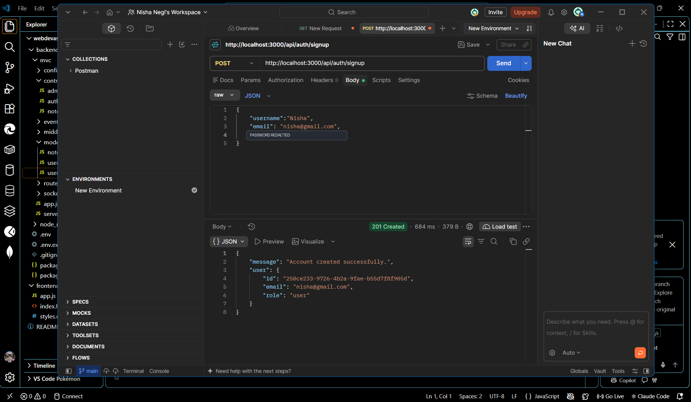
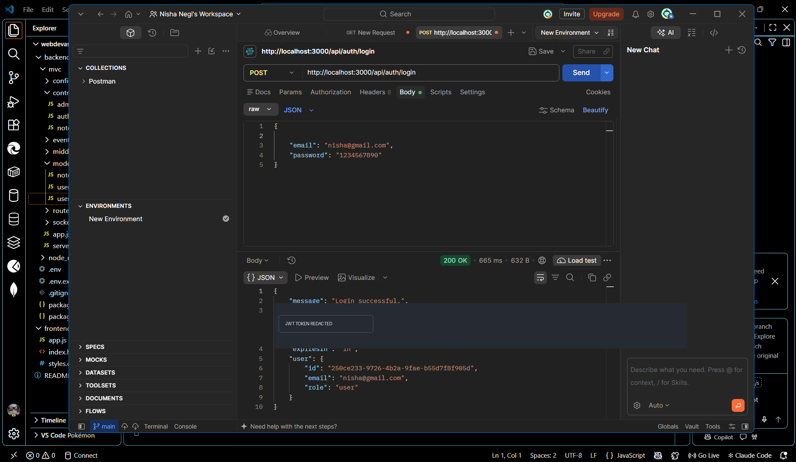
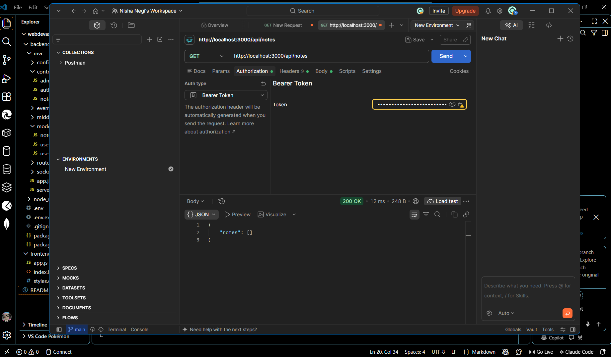
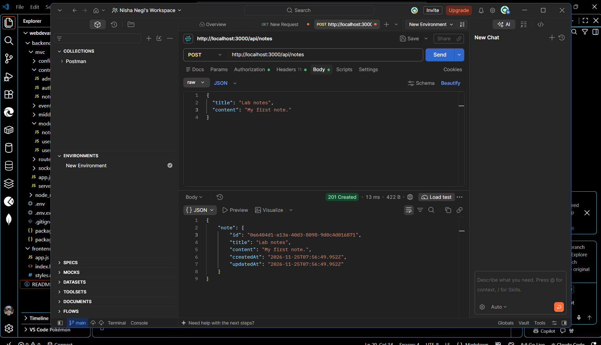
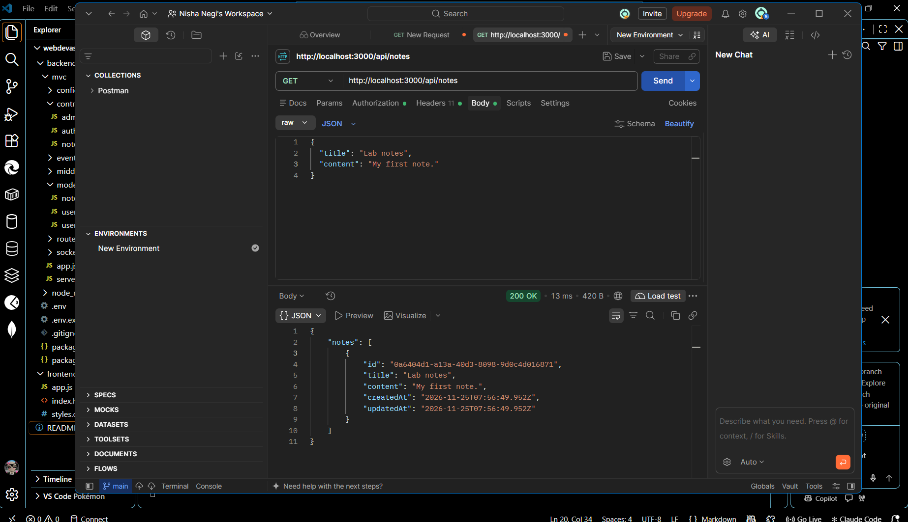
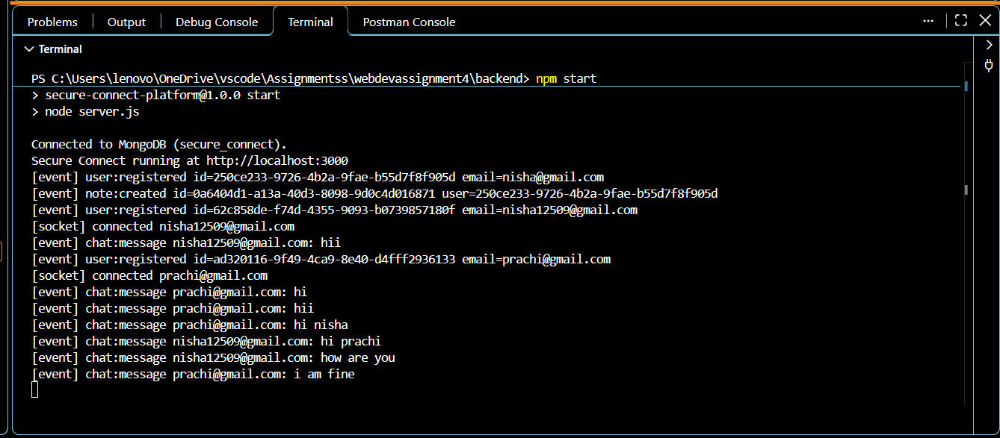

# Secure Connect and Communication Platform

Lab 4 implementation for Web Dev III. It demonstrates signup and login, bcrypt password hashing, JWT authentication, role-based access control, a per-user Notes API, authenticated Socket.IO chat, and Node's EventEmitter.

## Run locally

1. Install Node.js 18 or newer and MongoDB Community Server (optional; the app falls back to in-memory storage if MongoDB is unavailable).
2. In `backend`, copy `.env.example` to `.env` and set a private `JWT_SECRET` of at least 24 characters. Change `ADMIN_EMAIL` to the email you want to assign the admin role to.
3. Run `npm install`, then `npm start` from `backend`.
4. Visit `http://localhost:3000` and create an account. Accounts matching `ADMIN_EMAIL` receive the admin role; all other signups receive the user role.

Backend code is organized under `backend/mvc`: `models` handle data access, `controllers` handle request behavior, `routes` map API paths, `middleware` handles JWT and role checks, and `sockets` handles authenticated chat. The MongoDB user collection schema is defined in `backend/mvc/models/userSchema.js` and enforced with MongoDB's `$jsonSchema` validator. Start the app from the `backend` folder with `npm start`.

MongoDB uses the `secure_connect` database by default. Set `MONGODB_URI` and `MONGODB_DB` in `.env` to use another local database. Without MongoDB, data is kept in memory and disappears when the server stops.

## API quick reference

| Method | Path | Access | Purpose |
| --- | --- | --- | --- |
| `GET` | `/api/health` | Public | Server and storage status |
| `POST` | `/api/auth/signup` | Public | Create a user (`username`, `email`, `password`) |
| `POST` | `/api/auth/login` | Public | Get a JWT (`email`, `password`) |
| `GET` | `/api/me` | Bearer JWT | Current user |
| `GET` | `/api/notes` | Bearer JWT | List your notes |
| `POST` | `/api/notes` | Bearer JWT | Create a note (`title`, `content`) |
| `PUT` | `/api/notes/:id` | Bearer JWT | Update your note |
| `DELETE` | `/api/notes/:id` | Bearer JWT | Delete your note |
| `GET` | `/api/admin/users` | Admin JWT | List accounts (no password hashes) |

Socket.IO clients authenticate with `io({ auth: { token } })`. Send `chat:message` with `{ "message": "Hello" }`; connected clients receive `chat:message`. EventEmitter logs account registration, note creation, and chat activity in the server console.

## Demonstration with curl

Create an account:

```sh
curl -i -X POST http://localhost:3000/api/auth/signup -H "Content-Type: application/json" -d '{"username":"student_01","email":"student@example.com","password":"securepass123"}'
```

Log in and copy the returned token:

```sh
curl -i -X POST http://localhost:3000/api/auth/login -H "Content-Type: application/json" -d '{"email":"student@example.com","password":"securepass123"}'
```

The notes endpoint returns 401 without a token. Pass the login token to use it:

```sh
curl -i http://localhost:3000/api/notes
curl -i http://localhost:3000/api/notes -H "Authorization: Bearer YOUR_JWT" -H "Content-Type: application/json" -d '{"title":"Lab notes","content":"JWT protects this note."}'
```

## Screenshots

These screenshots show the API requests and server output. The signup password and login JWT have been redacted in the copies stored in this project.

### Signup response



### Login response



### Protected notes request



### Create a note



### List notes



### Socket.IO chat activity



## Security notes

- Passwords are hashed with bcrypt and are never returned by the API.
- Tokens are signed with a secret loaded from `.env`; keep `.env` private and rotate the secret outside a demo environment.
- New signups cannot choose their own role. Set `ADMIN_EMAIL` before signup to designate an admin account.
- Notes are always scoped to the authenticated user's ID, including update and delete operations.
- Chat requires a valid JWT at Socket.IO connection time and limits message length to 500 characters.
